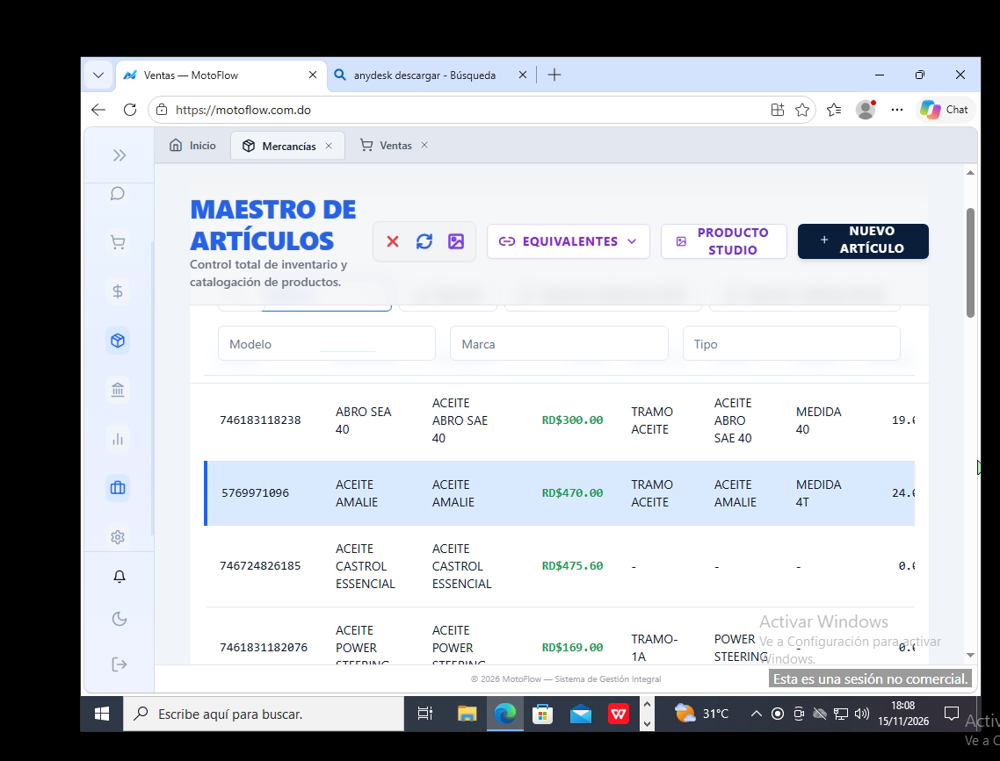

# Mercancías: el encabezado tapa los filtros en pantalla angosta

**Fecha:** 15/11/2026 · **Pedido por:** el dueño ("guarda esa foto para un arreglo más adelante")

## Qué se ve (Maestro de Artículos, ventana de ~1000 px, PC de la tienda con AnyDesk)
- El título "MAESTRO DE ARTÍCULOS" se parte en dos líneas y los botones (✕, recargar, imagen, Equivalentes, Producto Studio, Nuevo Artículo) se amontonan.
- La fila de pestañas / buscador queda **tapada** detrás del encabezado: solo asoma el borde de abajo.
- Los filtros Modelo / Marca / Tipo sí se ven.
- La tabla se corta a la derecha: la columna de existencia sale como "19.(", "24.(", "0.(".

## Por arreglar
- Encabezado que se acomode (o se achique) en anchos de 900–1100 px sin tapar las pestañas.
- La tabla con scroll horizontal o columnas que quepan, sin cortar la existencia.
